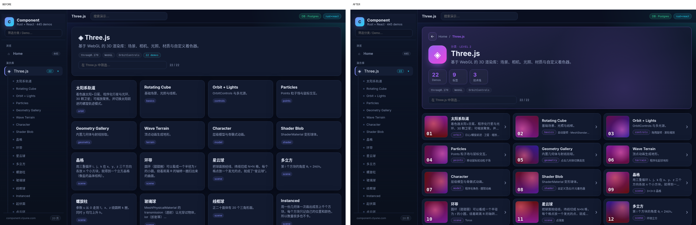
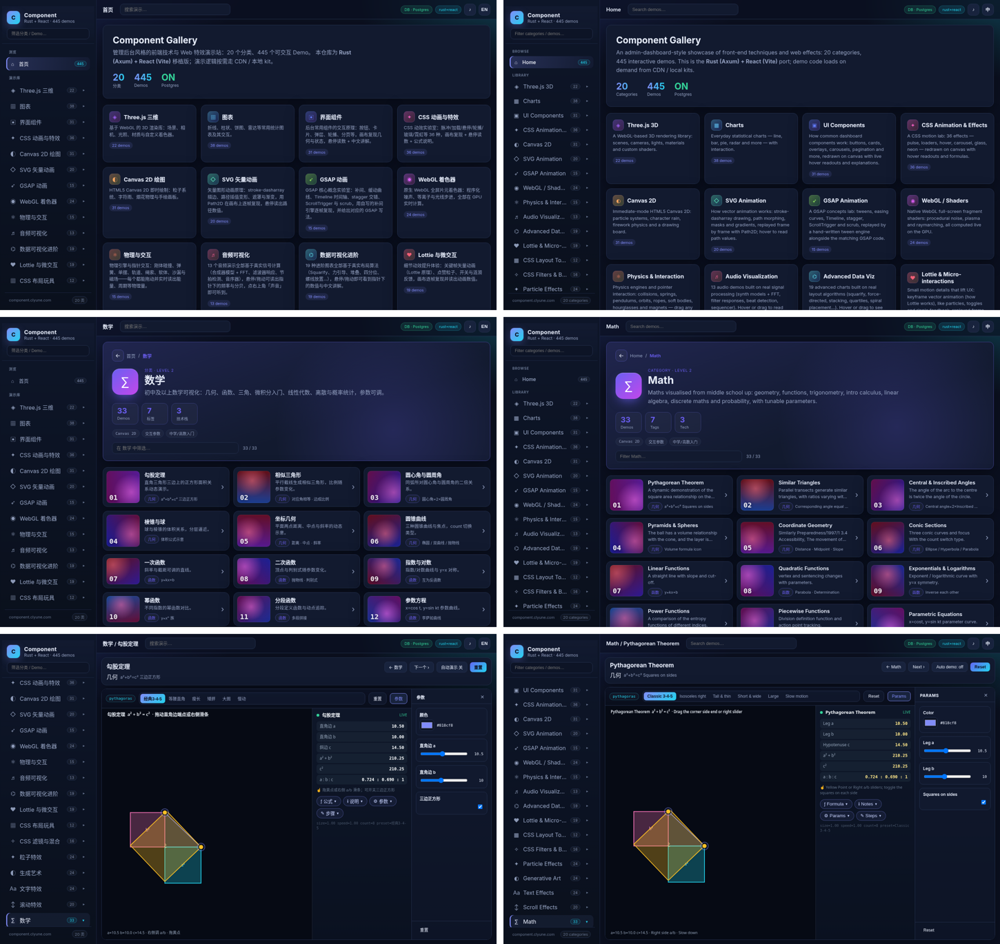
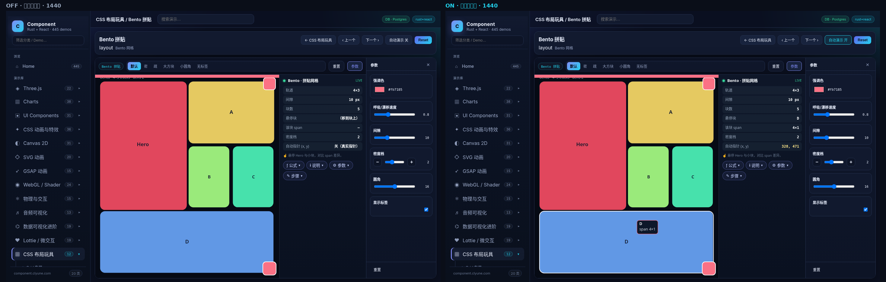
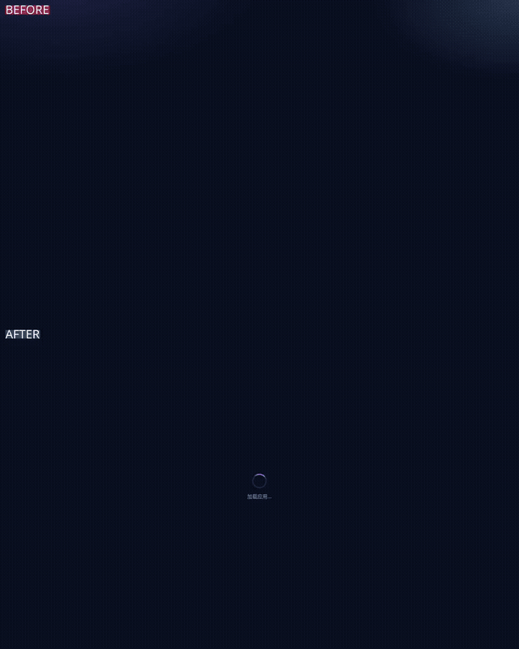

<div align="center">


# Clyune Component

**445 interactive web-motion demos you can tweak live, each with beginner-friendly explanations.**

Three.js · Canvas · WebGL shaders · physics · charts · GSAP · math visualization · unit conversion. Everything runs in your browser: drag a slider and the picture and the numbers update immediately.

[](https://component.clyune.com)
[](https://github.com/tianszpochika-cmd/clyune-component/stargazers)
[](LICENSE)
[](https://x.com/tiansongzhenam)

[简体中文](README.md) | **English**

</div>

> ⭐ **If you find this useful, please give it a Star.** It's the best way to support the project and help others discover it.



## ✨ Features

- **445 demos in 20 categories**, from a 3D solar system and fluid particles to the Pythagorean theorem and number bases
- **Every knob really works.** Each parameter is checked by a script to make sure it visibly changes the output
- **Live data readout** that updates while you drag
- **Beginner-friendly notes** on every demo: formula, explanation, parameters, usage
- **Chinese / English** switch at the top-right, defaulting to your browser language
- **Auto-demo toggle**, off by default, so nothing moves unless you move it
- **Background music** synthesized in the browser (no audio files) that keeps playing across demos; off by default
- **Works on slow networks**, with a loading progress animation instead of a black stage
- **Mobile-ready**: no overlapping controls, full-size stage, page transitions
- **Very light on the server**: all rendering happens client-side, and the API uses about 30 MB of RAM

## 📸 Preview

| Language switch | Home cards |
|---|---|
|  |  |

<p align="center"></p>

## 🗂 Categories

| key | Category | Demos |
|---|---|---|
| `threejs` | Three.js 3D | 22 |
| `charts` | Charts | 38 |
| `ui` | UI components | 31 |
| `css-fx` | CSS animation & effects | 36 |
| `canvas` | Canvas 2D | 31 |
| `svg` | SVG animation | 20 |
| `gsap` | GSAP animation | 15 |
| `webgl` | WebGL shaders | 24 |
| `physics` | Physics & interaction | 15 |
| `audio` | Audio visualization | 13 |
| `dataviz` | Advanced data viz | 19 |
| `micro` | Lottie & micro-interactions | 19 |
| `layout` | CSS layout toys | 12 |
| `filters` | CSS filters & blending | 16 |
| `particles-fx` | Particle effects | 24 |
| `generative` | Generative art | 24 |
| `text-fx` | Text effects | 24 |
| `scroll-fx` | Scroll effects | 20 |
| `math` | Math | 33 |
| `convert` | Unit conversion | 9 |
| | **Total** | **445** |

> Counts come straight from `frontend/public/registry.json`.

## 🧱 Tech stack

| Layer | Tech |
|---|---|
| Frontend | React 18 · Vite · TypeScript · React Router |
| Rendering | Three.js 0.170 · Canvas 2D · WebGL · SVG · CSS |
| Libraries | GSAP · Matter.js · ECharts · D3 · Chart.js · Lottie (loaded from CDN on demand) |
| Backend | Rust · Axum · sqlx |
| Database | Postgres 16 (optional; falls back to the bundled `registry.json`) |
| Deploy | Docker Compose |

## 🚀 Quick start

**Frontend only:**

```bash
git clone https://github.com/tianszpochika-cmd/clyune-component.git
cd clyune-component/frontend
npm install
npm run dev        # http://localhost:5173, /api is proxied to 127.0.0.1:8080
```

**Frontend + Rust API:**

```bash
cp .env.example .env
docker compose up -d db                 # Postgres only (optional)
cd frontend && npm install && npm run build && cd ..
cd backend && cargo run                 # without DATABASE_URL it reads registry.json
```

**Full Docker (API + DB):**

```bash
cp .env.example .env    # change POSTGRES_PASSWORD before deploying
docker compose --profile full up -d --build
# open http://localhost:8080
```

## 📁 Project structure

```
frontend/
  src/
    App.tsx, main.tsx       shell, routing, top bar
    registry.ts             client-side registry (routes / sidebar)
    demoLoader.ts           lazy-loads demo modules by name
    demos/                  standalone demos (mount functions, ESM)
    demos/kits/             per-category kits; one kit renders many demos via variant
    lib/                    canvas, CDN loader, i18n, music, progress, auto-demo
    i18n/                   English strings
  public/registry.json      metadata for every category and demo (zh + en)
  *-audit.mjs               Playwright QA scripts (knobs, info, overlap, motion, slow network)
backend/
  src/                      Axum API + sqlx
  migrations/               Postgres schema
  data/registry.json        seed data / JSON fallback
scripts/                    generation and translation helpers
```

API: `GET /api/health` · `GET /api/categories` · `GET /api/demos/:category/:slug`

## ➕ Adding a demo

1. Create a module in `frontend/src/demos/` that exports `mount(host, opts)`, renders into `host`, and **returns a cleanup function** (stop animation loops, remove listeners). To reuse a category's control and info panels, add a new variant to the matching `demos/kits/kit-*.js` instead.
2. Register new files in `frontend/src/demoLoader.ts`.
3. Add an entry to the category's `demos` array in `frontend/public/registry.json` (`slug`, `title`/`title_en`, `hint`, `desc`, `mod`, `fn`, `variant`, `presets`), and mirror it in `backend/data/registry.json`.
4. Run `npm run build`, start `npx vite preview --port 4179`, then run the checks such as `node knob-audit.mjs` and `node overlap-audit.mjs`.

See [CONTRIBUTING.md](CONTRIBUTING.md).

## 🤝 Contributing

Issues and PRs are welcome: new demos, bug fixes, better English copy, performance work. Please read [CONTRIBUTING.md](CONTRIBUTING.md) first.

## 🗺 Roadmap

- [ ] Better English explanations (some are machine-translated today)
- [ ] Copy source / open in CodePen for every demo
- [ ] Lighter Three.js scenes for low-end GPUs
- [ ] New categories: algorithm visualization, chemistry, music theory
- [ ] Shareable links that keep knob values
- [ ] More languages

## ⭐ Star the project

If this project taught you something, sparked an idea, or saved you time writing a demo, **please leave a Star ⭐**. Every star keeps new demos coming.

[](https://star-history.com/#tianszpochika-cmd/clyune-component&Date)

## 📄 License

[MIT](LICENSE) © 2026 tianszpochika-cmd
