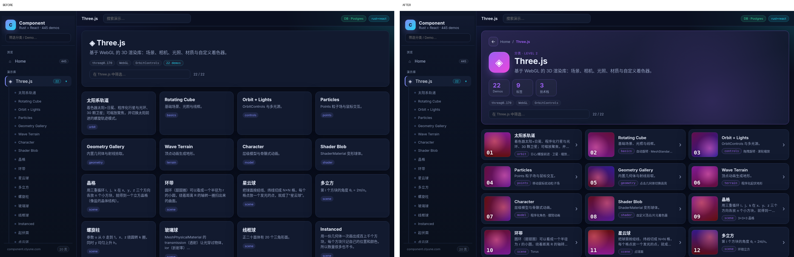
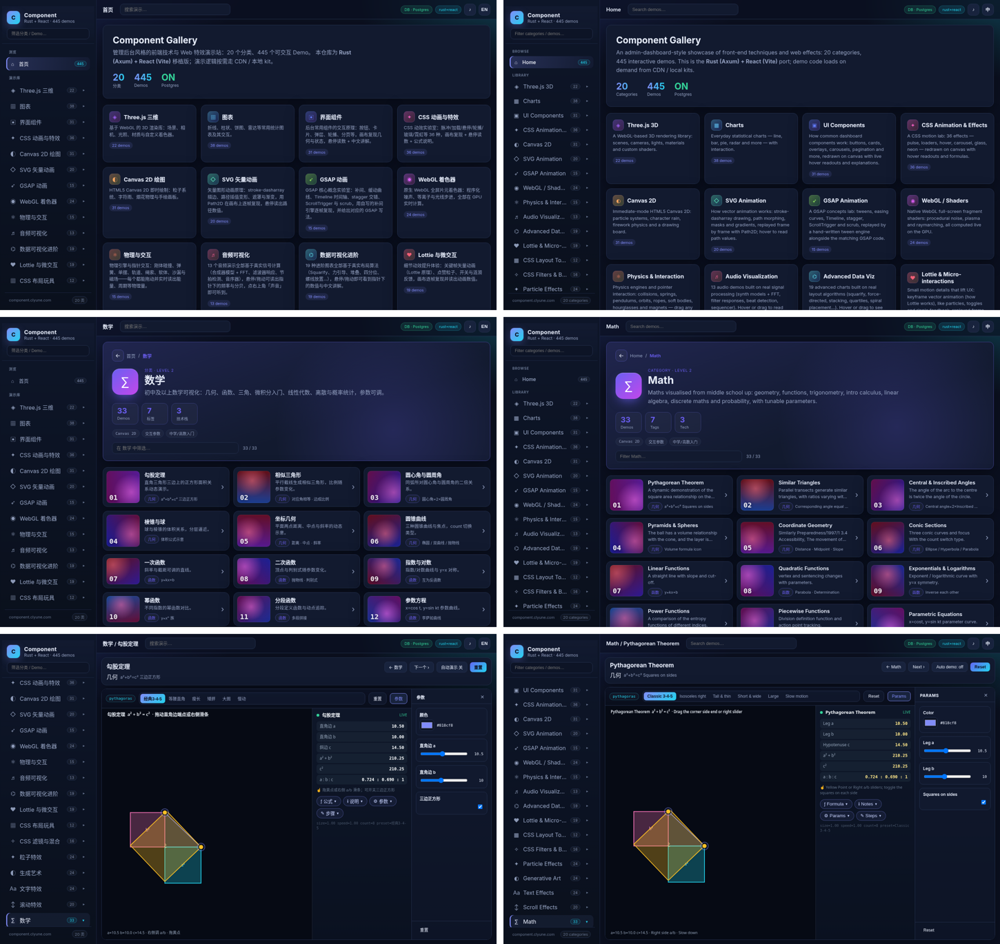
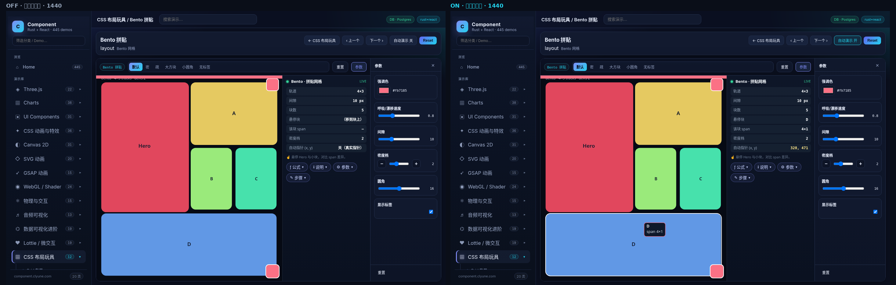
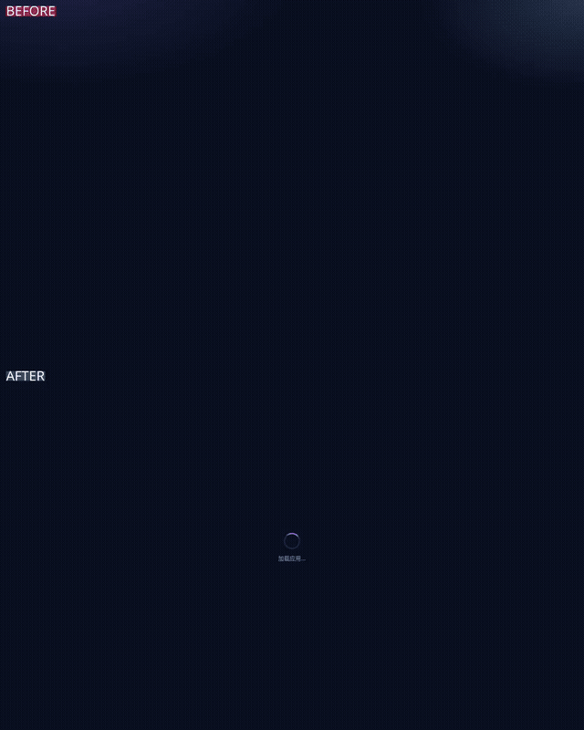

<div align="center">


# 云澜 Clyune Component

**445 个可以直接上手调的交互式 Web 动效 Demo，每个都配有给新手看的中文讲解。**

Three.js · Canvas · WebGL 着色器 · 物理 · 图表 · GSAP · 数学可视化 · 单位换算……打开浏览器就能玩，滑块一拖，画面和数据马上跟着变。

[](https://component.clyune.com)
[](https://github.com/tianszpochika-cmd/clyune-component/stargazers)
[](LICENSE)

**简体中文** | [English](README.en.md)

</div>

> ⭐ **觉得有用的话，请点右上角的 Star 支持一下。** 这是对作者最大的鼓励，也能让更多人看到这个项目。



## ✨ 特性

- **445 个 Demo，20 个分类**：从 3D 太阳系、流体粒子到勾股定理、进制转换都有
- **只放真正起作用的旋钮**：每个参数都经过脚本自动检查，拖动后画面一定会变化
- **实时数据读数**：拖动参数时，数值、公式结果会同步显示
- **新手友好的中文说明**：每个 Demo 都有「公式 / 说明 / 参数 / 用法」，初中生也能看懂
- **中英双语**：右上角一键切换，默认跟随浏览器语言
- **自动演示开关**：默认关闭，由你自己操作，不会出现莫名其妙的"鼠标自己在动"
- **背景音乐**：在浏览器里实时合成，没有音频文件，切换 Demo 时不中断，默认关闭
- **慢网络友好**：加载时显示进度动画，不会出现黑屏
- **移动端适配**：手机上控件不重叠、舞台占满，并有页面过渡动画
- **非常轻量**：所有渲染都在浏览器里完成，服务器只负责静态文件和一个很小的 API（内存约 30 MB）

## 📸 预览

| 中英文切换 | 首页卡片 |
|---|---|
|  |  |

<p align="center"></p>

## 🗂 分类一览

| key | 分类 | Demo 数 |
|---|---|---|
| `threejs` | Three.js 三维 | 22 |
| `charts` | 图表 | 38 |
| `ui` | 界面组件 | 31 |
| `css-fx` | CSS 动画与特效 | 36 |
| `canvas` | Canvas 2D 绘图 | 31 |
| `svg` | SVG 矢量动画 | 20 |
| `gsap` | GSAP 动画 | 15 |
| `webgl` | WebGL 着色器 | 24 |
| `physics` | 物理与交互 | 15 |
| `audio` | 音频可视化 | 13 |
| `dataviz` | 数据可视化进阶 | 19 |
| `micro` | Lottie 与微交互 | 19 |
| `layout` | CSS 布局玩具 | 12 |
| `filters` | CSS 滤镜与混合 | 16 |
| `particles-fx` | 粒子特效 | 24 |
| `generative` | 生成艺术 | 24 |
| `text-fx` | 文字特效 | 24 |
| `scroll-fx` | 滚动特效 | 20 |
| `math` | 数学 | 33 |
| `convert` | 单位换算 | 9 |
| | **合计** | **445** |

> 数量直接统计自 `frontend/public/registry.json`。

## 🧱 技术栈

| 层 | 技术 |
|---|---|
| 前端 | React 18 · Vite · TypeScript · React Router |
| 渲染 | Three.js 0.170 · Canvas 2D · WebGL · SVG · CSS |
| 动画 / 库 | GSAP · Matter.js · ECharts · D3 · Chart.js · Lottie（按需从 CDN 加载） |
| 后端 | Rust · Axum · sqlx |
| 数据库 | Postgres 16（可选；未配置时回退到内嵌的 `registry.json`） |
| 部署 | Docker Compose |

## 🚀 快速开始

**只跑前端（最简单）：**

```bash
git clone https://github.com/tianszpochika-cmd/clyune-component.git
cd clyune-component/frontend
npm install
npm run dev        # http://localhost:5173 ，/api 代理到 127.0.0.1:8080
```

**前端 + Rust API（本地开发）：**

```bash
cp .env.example .env
docker compose up -d db                 # 只启动 Postgres（可选）
cd frontend && npm install && npm run build && cd ..
cd backend && cargo run                 # 不设置 DATABASE_URL 时直接读 registry.json
```

**完整 Docker（API + DB 一起）：**

```bash
cp .env.example .env    # 部署前请修改 POSTGRES_PASSWORD
docker compose --profile full up -d --build
# 打开 http://localhost:8080
```

## 📁 项目结构

```
frontend/
  src/
    App.tsx, main.tsx       页面框架、路由、顶部栏
    registry.ts             前端侧的 Demo 注册表（路由 / 侧边栏）
    demoLoader.ts           按 mod 名懒加载 Demo 模块
    demos/                  独立 Demo（mount 函数，ESM）
    demos/kits/             各分类的 kit：一个 kit 通过 variant 生成多个 Demo
    lib/                    canvas、CDN 加载、i18n、音乐、进度、自动演示
    i18n/                   英文文案
  public/registry.json      全部分类和 Demo 的元数据（中英文）
  *-audit.mjs               Playwright 质量检查脚本（旋钮/说明/重叠/动效/慢网络）
backend/
  src/                      Axum API + sqlx
  migrations/               Postgres 表结构
  data/registry.json        种子数据 / JSON 回退
scripts/                    生成与翻译脚本
```

API：`GET /api/health` · `GET /api/categories` · `GET /api/demos/:category/:slug`

## ➕ 添加一个 Demo

1. 在 `frontend/src/demos/` 新建一个模块，导出 `mount(host, opts)`，在 `host` 里渲染，并**返回一个清理函数**（停止动画、移除监听）。
   想复用现成分类的参数面板和说明面板，可以在对应 `demos/kits/kit-*.js` 里加一个新的 variant。
2. 在 `frontend/src/demoLoader.ts` 注册模块（如果是新文件）。
3. 在 `frontend/public/registry.json` 对应分类的 `demos` 里加一条：`slug`、`title`/`title_en`、`hint`、`desc`、`mod`、`fn`、`variant`、`presets`，并同步到 `backend/data/registry.json`。
4. 运行 `npm run build`，再用 `node knob-audit.mjs`、`node overlap-audit.mjs` 等脚本检查（需要先 `npx vite preview --port 4179`）。

详见 [CONTRIBUTING.md](CONTRIBUTING.md)。

## 🤝 参与贡献

欢迎提 Issue 和 PR：新 Demo、Bug 修复、英文文案润色、性能优化都可以。提交前请读一下 [CONTRIBUTING.md](CONTRIBUTING.md)。

## 🗺 路线图

- [ ] 提升英文说明质量（目前部分为机器翻译）
- [ ] 每个 Demo 一键复制源码 / 在 CodePen 打开
- [ ] 低端 GPU 上简化部分 Three.js 场景
- [ ] 更多分类：算法可视化、化学、音乐理论
- [ ] 每个 Demo 可分享带参数的链接
- [ ] 支持更多语言

## ⭐ Star 一下吧

如果这个项目帮你学到了东西、找到了灵感，或者让你省了写 Demo 的时间，**请点一个 Star ⭐**。每一个 Star 都会让我更有动力继续加新 Demo。

[](https://star-history.com/#tianszpochika-cmd/clyune-component&Date)

## 📄 许可证

[MIT](LICENSE) © 2026 tianszpochika-cmd
